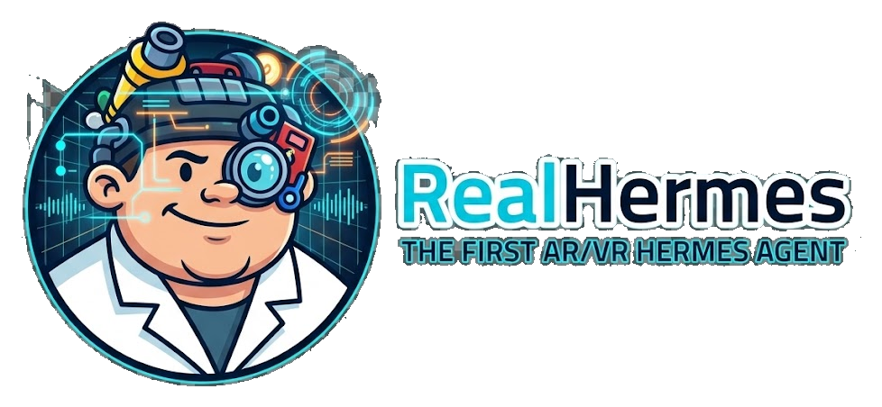
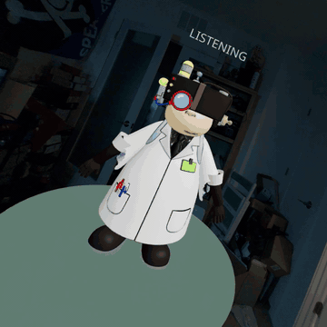

# RealHermes

<p align="center"></p>

**RealHermes gives your [Hermes Agent](https://hermes-agent.nousresearch.com/docs/) a body: in AR, VR and on your desktop.** By default, **2x4** (pronounced "two by four") is your spatial companion for Hermes Agent, in a desktop simulator and in WebXR headsets.

RealHermes is a browser app plus a small loopback Node relay. You talk to 2x4 by text or push-to-talk voice and it answers out loud. When an answer depends on what you are looking at, Hermes takes a still of your headset view and looks at it. PDFs and images that Hermes finds open as panels that you can page, move and resize in the scene. It was built and exercised with a Valve Steam Frame.

## Demo

<p align="center"><a href="https://videos.files.wordpress.com/nBQBv0Ah/realhermes-demo.mp4"></a></p>

Watch the full demo: [HERE](https://videos.files.wordpress.com/nBQBv0Ah/realhermes-demo.mp4)

## Features

| Capability | Desktop simulator | WebXR VR / AR | Notes |
| --- | --- | --- | --- |
| Text chat with streamed answers | Yes | Use voice (no text entry in XR) | One fixed Hermes conversation; the browser keeps display history only |
| Push-to-talk voice | Microphone button, or hold the left mouse button on the canvas | Hold the right controller trigger | Up to 60 s per recording; digital silence is detected before upload |
| Spoken replies | Yes | Yes | Hermes text-to-speech; link-only answers are spoken as a short phrase |
| Live state cue | Yes | Yes | `idle`, `listening`, `thinking`, `working` (real Hermes tool calls only), `speaking`, `error` |
| Seeing what you see | No | Yes, with the bundled Hermes plugin | Hermes decides when an answer needs your current view, calls `steam_frame_capture` for one still (passthrough included) and inspects it with its vision tool |
| Web PDFs and images in the scene | Yes | Yes | The relay loads the file Hermes links before the turn completes and asks Hermes for another source when a link is dead; PDFs need Poppler |
| Local images and PDFs | Yes | Yes | Off by default; searched by the relay only inside folders you approve |
| Panel paging, closing, moving and resizing | Buttons, drag and two-finger scale | Trigger on controls; grip squeeze or trigger drag to hold | Placement stays within readable bounds |
| Companion placement | Height and distance sliders | Same placement | No AR hit testing or anchors |
| Production runtime | Built app and API on one loopback origin | Reached through a reverse SSH tunnel | `npm run prod`, with an owned audio backend and optional tunnel reconnects |


## How it fits together

```text
Browser or headset (React, three.js, WebXR)
   │  same-origin /api only; no credentials in the browser
   ▼
RealHermes relay (Express, 127.0.0.1)
   ├──▶ Hermes gateway API server   /v1/responses, bearer key        (chat, tools, vision)
   │     └─ steam_frame_capture     a Hermes plugin: one still of the wearer's view over SSH
   ├──▶ Hermes audio backend        /api/audio/*, session token      (speech-to-text, text-to-speech)
   ├──▶ HTTPS PDF/image sources     DNS-pinned, no credentials sent  (artifacts from answers)
   └──◀ approved local folders      optional, read-only              ("show me ... from my computer")
```

[docs/architecture.md](docs/architecture.md) describes every component, data flow, opaque artifact ID and security boundary.

## Quick start

You need Node.js 22.12+, 24 or 26+, a running Hermes Agent gateway with its API server enabled, and, for voice, Hermes speech providers plus `ffmpeg`. Poppler is optional (PDF pages). Full instructions for macOS and Linux are in [docs/installation.md](docs/installation.md).

```sh
git clone https://github.com/gainsec/realhermes.git realhermes
cd realhermes
npm ci
npm run setup:env     # creates .env with owner-only permissions; never overwrites an existing .env
# Edit .env: set HERMES_API_KEY to the value of your gateway's API_SERVER_KEY.
npm run doctor        # read-only checks of Node, model, Hermes, Poppler, ports and settings
npm run dev:full      # Vite + relay + a local Hermes audio backend (needs `hermes` on PATH)
```

Open <http://127.0.0.1:5173> in a desktop browser, type a message or hold the canvas to talk. To use a headset, run the production workflow with the reverse tunnel described in [docs/production.md](docs/production.md) and [docs/headset.md](docs/headset.md).

## Ways to run it

| Command | What runs | Use it for |
| --- | --- | --- |
| `npm run dev` | Vite on 127.0.0.1:5173 and the relay on 127.0.0.1:3001 | Development with an audio backend you run yourself (`HERMES_AUDIO_*`) |
| `npm run dev:full` | The above plus `hermes serve` on 127.0.0.1:9119 with a fresh random token | Development with local voice |
| `npm start` | The relay only | API work |
| `npm run preview` | Vite preview of `dist` (no `/api` proxy) | Checking the static build |
| `npm run prod` | Build once, then app and API on one loopback origin, an owned audio backend and an optional reverse tunnel | Daily use with a headset |

None of these start, stop or reconfigure the Hermes messaging gateway, and none ever kill a process they did not start.

## Documentation

- [Installation](docs/installation.md): prerequisites, compatibility, macOS and Linux setup, Hermes Agent setup.
- [Configuration](docs/configuration.md): every setting in [`.env.example`](.env.example), approved folders, Poppler, the relay log.
- [Architecture](docs/architecture.md): components, data flows, API and event contracts, opaque IDs.
- [Security and privacy](docs/security-privacy.md): trust boundaries, what leaves your machine, what is stored.
- [Production operation](docs/production.md): `npm run prod`, readiness, reverse SSH tunnel, health checks, stop and recovery.
- [Headsets and WebXR](docs/headset.md): secure contexts, Steam Frame notes, controller mapping, limits.
- [Troubleshooting](docs/troubleshooting.md): microphone silence, gateway routing, headset vision, tunnels, artifacts, WebXR.
- [Development](docs/development.md): project layout, tests, gates, CI.
- [Contributing](CONTRIBUTING.md) and [Security policy](SECURITY.md).
- [AGENTS.md](AGENTS.md): a guide for AI agents (Hermes Agent, Claude Code, Codex) that install, run, troubleshoot or extend RealHermes; `hermes-skills/realhermes-operator/` packages it as a Hermes skill.

## Development checks

```sh
npm test        # Vitest: relay, launcher, browser client and scene behavior (no network, no Hermes)
npm run lint    # oxlint
npm run build   # type-check client and server, then the production bundle
npm run verify  # all of the above plus the plugin tests and git whitespace checks
```

## Authors

- Jon "GainSec" Gaines, [gainsec.com](https://gainsec.com)

## License and attribution

RealHermes is copyright 2026 GainSec and licensed under the [RealHermes Source-Available License](LICENSE): personal and non-commercial use with attribution. Commercial use requires a separate commercial license; ask GainSec, the owner of this repository, through the repository. When you share or demonstrate RealHermes or work based on it, credit "RealHermes and the 2x4 companion by GainSec".

Hermes Agent is a separate project with its own license; RealHermes does not include it. npm dependencies, Poppler, ffmpeg and the fonts that in-world text loads at runtime are licensed by their respective owners.
