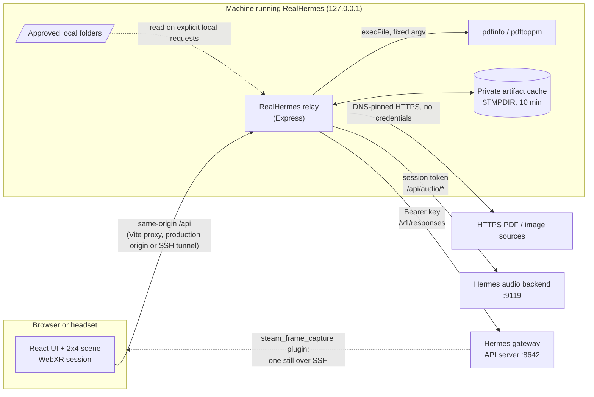

# Architecture

RealHermes is three pieces of its own: a React/three.js browser app, an Express relay, and two launchers. It sits between a person (on a desktop or in a headset) and Hermes Agent services that run separately. This page describes how the pieces fit and how data moves. [security-privacy.md](security-privacy.md) covers trust boundaries and [configuration.md](configuration.md) covers settings.

## Components

| Component | Code | Runs where | Responsibility |
| --- | --- | --- | --- |
| Browser app | `src/` | Desktop browser or headset browser | 2x4 avatar and scene (React Three Fiber, `@react-three/xr`), conversation UI, microphone recording, playback, artifact panel, controller input. Talks only to same-origin `/api`. |
| Relay | `server/app.ts` and friends | Node, bound to `127.0.0.1` | Validates every browser request, holds all credentials, forwards chat and audio to Hermes, loads and renders the files Hermes links before a turn completes, finds local files. |
| Production server | `server/production.ts` | Node, `127.0.0.1:5173` by default | Serves the built `dist/` and the relay on one origin with security headers, readiness and graceful shutdown. |
| Development launcher | `scripts/dev-with-hermes.mjs` | Your terminal | `npm run dev:full`: starts `hermes serve` on 9119 with a fresh token, plus Vite and the relay. |
| Production launcher | `scripts/production.mjs`, `scripts/hermes-production.py` | Your terminal | `npm run prod`: starts and owns a headless Hermes audio backend and the production server, checks readiness, optionally keeps a reverse SSH tunnel to the headset. |
| Doctor and setup | `scripts/doctor.mjs`, `scripts/init-env.mjs` | Your terminal | Read-only preflight checks and a no-overwrite `.env` initializer. |
| Hermes gateway API server | Hermes Agent | Separately managed | The agent: model, tools, memory, and the named conversation `realhermes-steam-frame-v3`. |
| Hermes audio backend | Hermes Agent dashboard web server | Started by a launcher or by you | Speech-to-text and text-to-speech with the providers configured in Hermes. |
| Headset view plugin | `hermes-plugins/steam-frame-view` | Inside Hermes | The `steam_frame_capture` tool: one still of what the wearer sees, fetched over SSH for Hermes' vision tool. |

## Data flow



The browser is the only component a person interacts with, and it never holds a credential. In development, Vite proxies `/api` to the relay. In production, one Express origin serves both. On a headset, a reverse SSH tunnel makes that origin appear at `http://127.0.0.1:<port>` on the headset itself.

## A conversation turn

1. **Input.** Text from the composer, or speech. A recording comes from the microphone button, a held left mouse button on the canvas, or the held right controller trigger. It stops on release, or automatically after 60 seconds. A recording whose decoded peak is at most one 16-bit step is digital silence (for example a headset microphone gated by standby). It is rejected in the browser instead of being uploaded.
2. **Transcription.** `POST /api/audio/transcribe` with `{ data_url, mime_type }`. The relay checks the MIME type, canonical base64 and a 10 MiB limit, then forwards the same JSON to the audio backend and normalizes `{ transcript }` to `{ text }`.
3. **Chat.** `POST /api/hermes/chat/stream` with `{ text }`. Every turn goes to `/v1/responses` on the fixed conversation `realhermes-steam-frame-v3` with `stream: true` and fixed `instructions`: answer as 2x4, call `steam_frame_capture` when the answer depends on what the wearer sees (see [seeing what the wearer sees](#seeing-what-the-wearer-sees)), and reply with a direct public HTTPS file URL to show a PDF or image. Nothing in the browser or relay classifies the words. Hermes owns the history; the browser keeps display history only.
4. **Streaming.** The relay reads Hermes' Responses-style SSE incrementally. It translates only real function-call starts into `working`, text deltas into `text`, and completion into `answer` plus `done` (table below). Tool names, arguments, reasoning and status payloads are never forwarded. Browser-facing events are capped at 64 KiB (upstream Hermes events at 12 MiB, because a vision tool result can carry an inline frame) and answers at 8,000 characters. The relay gives one Hermes request 120 seconds and the whole turn's file checks 150 seconds; the browser gives up after 125 seconds without any event. Browser disconnects abort the upstream request. There is no automatic retry, which would duplicate a turn in the shared conversation.
5. **Speech.** `POST /api/audio/speak` with the answer text; the relay validates the returned audio data URL. An answer that is only a link is spoken as "Here's the image.", "Here's the PDF." or "Here's the link.", because Hermes speech drops bare URLs. The visible answer stays exact.
6. **Artifact.** If the answer links a supported file, the relay loads it before marking the turn complete (see below) and sends an `artifact` event. The browser opens that panel by opaque ID once `done` arrives; it never fetches links itself.

The scene shows the state as a colored label and floor ring: `idle`, `listening`, `thinking`, `working` (only when Hermes really starts a tool), `speaking` (only once playback starts) and `error` (retryable without reloading).

### Browser-facing event stream

| Event | Data | Meaning |
| --- | --- | --- |
| `working` | `{}` | Hermes started a named function call, or the relay is checking a file link. |
| `text` | `{ "delta": "..." }` | Fragment of the answer. |
| `reset` | `{}` | The relay superseded the text so far (a link it could not load); only text after the last `reset` forms the answer. Never after `artifact`. |
| `artifact` | `{ "id", "kind", "title", "pageCount" }` | A file the relay has loaded and rendered page 1 of, from a verified link or an approved folder; at most one, before `answer`. |
| `answer` | `{ "text": "..." }` | The complete answer; must equal the accumulated deltas. |
| `done` | `{}` | Successful completion. |
| `error` | `{ "error": "Hermes request failed" }` | Sanitized failure; no `done` follows. |

Both SSE parsers handle arbitrary chunk boundaries, LF, CR and CRLF framing, and multi-line data. The browser rejects malformed, oversized, out-of-order, errored or incomplete streams.

### Relay API

| Route | Purpose |
| --- | --- |
| `GET /api/health` | `{ status, chatConfigured, audioConfigured }`. Configuration flags only, not a connectivity probe. |
| `GET /api/ready` | Production only: `{ appRunning, chatConfigured, audioConfigured, upstreamConnectivity: "not-probed" }`; 503 while stopping. |
| `POST /api/hermes/chat/stream` | Streaming chat (above); used by the browser. |
| `POST /api/hermes/chat` | Same input and validation, JSON reply `{ text }` or `{ text, artifact }`. |
| `POST /api/audio/transcribe`, `POST /api/audio/speak` | Audio, as above. |
| `POST /api/artifacts` | `{ url }` → `{ id, kind, title, pageCount, sourceUrl }` for an HTTPS PDF or image. Kept for tooling; the browser no longer calls it. |
| `GET /api/artifacts/:id/pages/:page` | One validated image, or one rasterized PDF page as PNG. |

Request bodies are limited to 15 MiB (to carry base64 audio) and 8 KiB for artifact requests; text is limited to 8,000 characters. Upstream failures are reduced to fixed messages, so credentials, URLs, paths and upstream error bodies never reach the browser.

## Seeing what the wearer sees

Looking is a Hermes capability, not a relay feature. The relay's fixed instructions tell Hermes that the user wears a Steam Frame headset and that, whenever an answer depends on what they can currently see, it should call `steam_frame_capture` and inspect the result with `vision_analyze`. That tool comes from the bundled plugin in `hermes-plugins/steam-frame-view`, installed into the Hermes profile ([configuration](configuration.md#seeing-what-the-wearer-sees)). It runs one fixed SSH command on the fixed `frame` alias: Framecorder records one second of the panel view, ffmpeg extracts a middle frame, and the JPEG is validated (magic bytes, dimensions, size, freshness) and written atomically into the profile's private cache. Hermes sees only that internal path; the relay never forwards tool names, arguments or results, so the browser sees `working` and then the answer. Nothing in the browser or relay matches phrases, so wording like "what is the orange thing over there?" works as well as "what am I looking at?".

## Artifacts

An artifact is one PDF or image shown as a textured panel next to 2x4. There are two ways in; both end in the same private cache and the same page route.

### From an answer (web)

Hermes is instructed to show a PDF or image by replying with its direct public HTTPS file URL. When the answer completes, the relay extracts explicit HTTPS links whose path ends in `.pdf`, `.png`, `.jpg`, `.jpeg` or `.webp` (Markdown links and reference definitions included), deduplicated in answer order, and does not mark the turn complete until it has loaded one. It tries at most three candidates in order, through the acquisition service below, and renders page 1. The first success becomes the `artifact` event, sent with the answer that offered it. If none loads, the relay logs sanitized diagnostics (link host and path and a reason code such as `http_404`; never queries, headers or bodies), sends `reset`, and asks Hermes on the same conversation for a different, checked source, telling it why each link failed. At most two such retries fit in the 150-second checking budget. If nothing loads, the answer becomes "I errored out while loading the artifact. Check the logs.", which is spoken and returns the UI to `idle`; the earlier claim is never shown. For each candidate, the relay:

1. validates the URL: HTTPS on port 443, no credentials, no control characters, no `localhost`/`.local`/`.internal`/`.onion` names and no private or reserved IP literals;
2. resolves DNS itself and refuses the URL if any answer is not a public address;
3. connects only to those validated addresses while still verifying the TLS certificate for the hostname, so a second DNS lookup cannot rebind. It offers HTTP/2 and HTTP/1.1 through ALPN, sends a fixed `RealHermes/0.0.0 (artifact viewer)` user agent and no credentials or cookies;
4. follows at most four redirects, re-validating the URL and DNS each time;
5. accepts only `application/pdf`, `image/png`, `image/jpeg` and `image/webp` with matching magic bytes, or `application/octet-stream` when both the extension and the magic bytes agree, with no content encoding;
6. bounds the whole operation to 30 seconds and 25 MiB, and images to 8,192 pixels per side and 16 million pixels;
7. counts PDF pages with `pdfinfo` (1 to 500 pages) and later rasterizes single pages on demand with `pdftoppm`, at most 1,600 pixels and 12 MiB per page.

### From approved folders (local)

A request such as "show me the invoice PDF from my computer" is recognized by the relay before Hermes is involved; see [configuration](configuration.md#approved-local-folders) for phrasing, matching and bounds. The relay answers in its own words and sends an `artifact` event with only `{ id, kind, title, pageCount }`. The browser opens the panel by that ID with no further acquisition request. Local requests are never forwarded to Hermes.

### Opaque IDs and the cache

Each stored artifact gets a fresh random 128-bit ID (32 hex characters), and its bytes go under that ID with fixed, server-chosen file names in a private, owner-only `$TMPDIR/realhermes-artifacts-*` folder. Clients see only the ID, kind, title, page count and, for web artifacts, the final validated HTTPS URL. No route accepts a path, and the original PDF is never served; pages are served only as validated image bytes, with `Cache-Control: no-store`, `nosniff`, a `default-src 'none'; sandbox` CSP and a same-origin resource policy. Entries expire after ten minutes. LRU eviction keeps at most eight artifacts and 100 MiB. Only one acquisition or rasterization runs at a time, and a concurrent request fails instead of queuing. IDs do not survive a restart.

### In the scene

The panel shows the title, the page, **Previous**, **Next** and **Close**, and a row of placement buttons (left, right, up, down, nearer, farther, smaller, larger, reset). It opens beside and slightly behind 2x4 and stays within readable bounds. On a desktop, drag its surface with the primary button to move it, or use two pointers to scale it. In XR, aim the trigger at a control to press it, drag the page with the trigger, or squeeze the grip to hold the panel like a book; it follows the hand, upright and unscaled. Presses on the panel are consumed so they cannot also start push-to-talk or orbit the camera. Releases are not consumed, so a hold started elsewhere still ends over the panel. Equivalent controls appear in the desktop footer while an artifact is open.

## Production topology

`npm run prod` builds once, then the launcher:

1. validates its settings and checks that the app and audio ports are free, without stopping anything;
2. generates a new random session token held only in memory;
3. starts the headless Hermes audio backend (`HERMES_PYTHON scripts/hermes-production.py`) and the production server, each in its own process group, with output suppressed because it can contain secrets;
4. waits up to 30 seconds for `/api/ready` and an authenticated `/api/host/identity`, then prints `Local services ready`;
5. if enabled, starts one reverse SSH tunnel at a time and keeps reconnecting with backoff.

A required child that exits, even with status 0, stops the whole workflow. On stop, the launcher signals only the process groups it started, and escalates to `SIGKILL` after three seconds. The gateway, any development servers and any processes it did not start are never touched. Details are in [production.md](production.md).

## Source layout

```text
public/models/realhermes-idle.glb   the 2x4 model (glTF binary, idle animation)
src/                                browser app: App.tsx, Simulator.tsx, ArtifactPanel.tsx, browser.ts (relay client),
                                    conversation.ts (turn state), artifact*.ts, *PushToTalk*, sse.ts
server/                             relay: app.ts (routes), config.ts (environment), artifacts.ts (acquisition, cache,
                                    Poppler), local-artifacts.ts, poppler.ts, production.ts, index.ts, production-index.ts
scripts/                            launchers, doctor, setup:env, verify.sh, Hermes production bootstrap
hermes-plugins/steam-frame-view/    the Hermes tool plugin that lets Hermes see the headset view
docs/                               this documentation
```

Tests sit next to the code they cover (`*.test.ts`, `*.test.tsx`); see [development.md](development.md).
